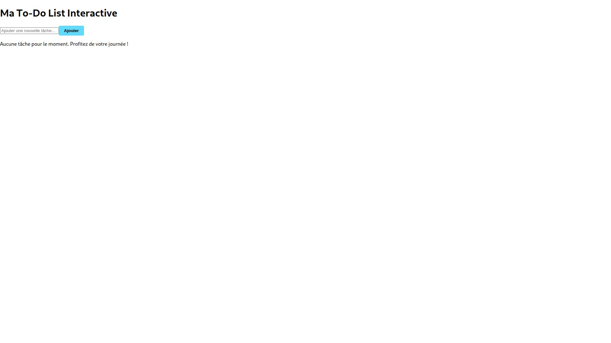
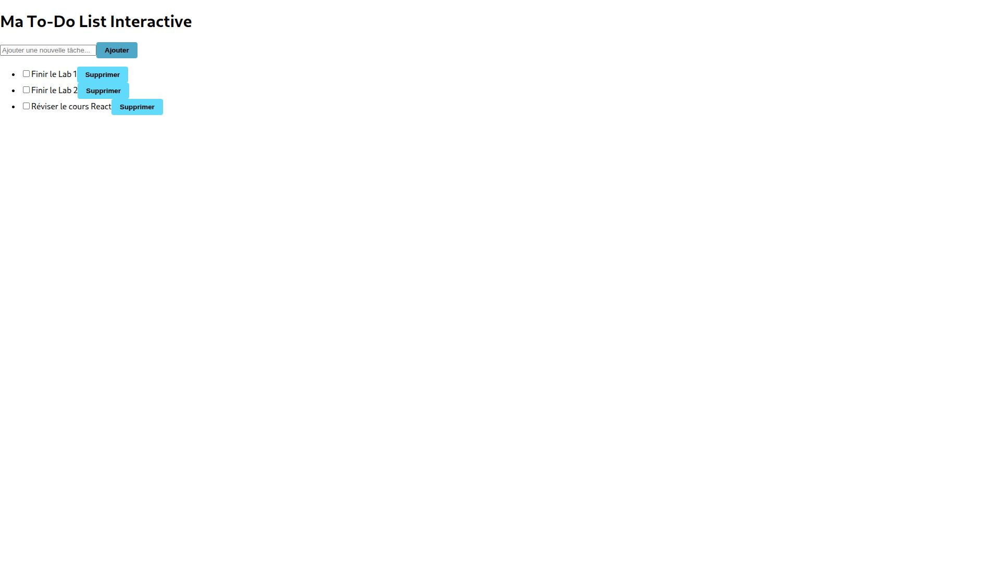
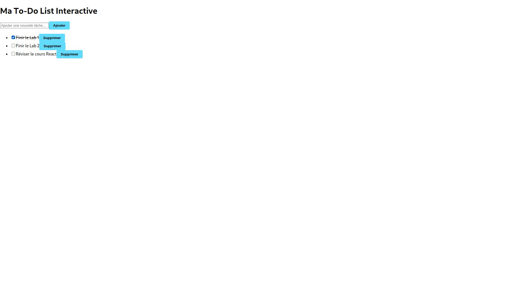
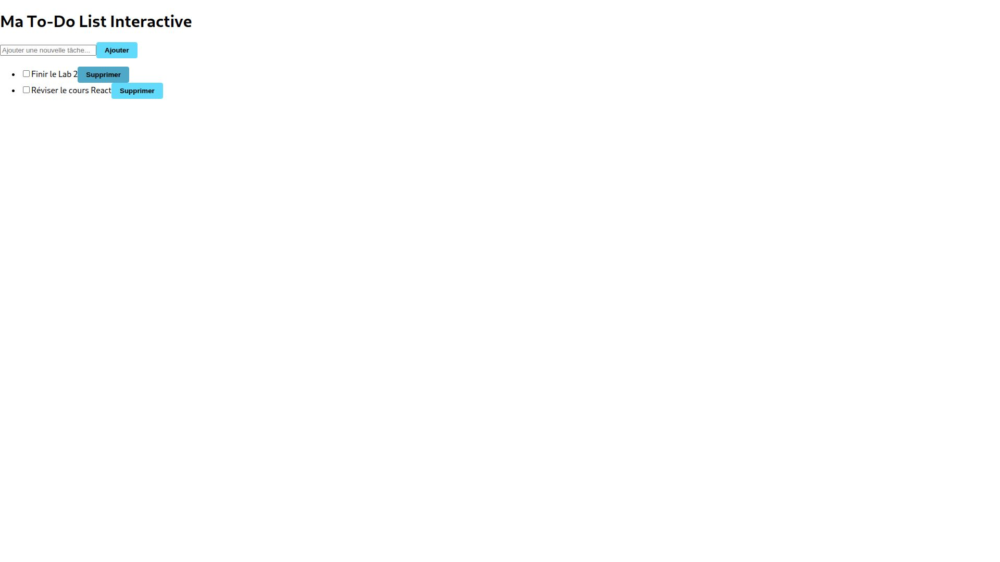

# Lab4-mon-projet-react

**Réalisé par : BOUDAD Yasser**

To-Do List interactive : ajout, état terminé et suppression.

La liste initiale est vide.

Tâches : « Finir le Lab 1 », « Finir le Lab 2 » et « Réviser le cours React ».

La tâche terminée est cochée et son texte est barré.

Après suppression de la première tâche, les deux autres restent affichées.

